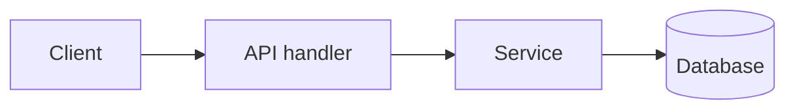

# Design: <Feature name>

**Slug:** `<slug>`  **Status:** Draft | Approved  **Date:** YYYY-MM-DD
**Spec:** [01-requirements.md](./01-requirements.md)

> The design turns the spec into a build plan. Every task names the requirement
> ID(s) it satisfies. The traceability table (§8) must cover **every** `AC-*` and
> `NFR-*` in the spec — a criterion with no task is a gap in the design.

## 1. Approach (5 lines max)

## 2. Components

| Component | Responsibility | New / Changed |
|-----------|----------------|---------------|

## 3. Data model changes
Tables / collections / fields added or changed, with migrations.

## 4. API contracts
| Method | Path | Request | Response | Errors |
|--------|------|---------|----------|--------|

## 5. File-by-file change plan
| File | Create / Modify | What and why |
|------|-----------------|--------------|

## 6. Risks and trade-offs
| Decision | Alternative rejected | Why |
|----------|----------------------|-----|

## 6b. Threat model (STRIDE-lite — do this before coding, not just at review)
For each new entry point / trust boundary, note the threat and the mitigation.
| Asset / entry point | Threat (spoof, tamper, disclose, DoS, escalate) | Mitigation | Covered by |
|---------------------|--------------------------------------------------|------------|------------|
| e.g. login endpoint | credential stuffing | rate limit + lockout | AC-2.1 |

## 7. Task checklist
Small, ordered tasks. Each task cites the requirement ID(s) it satisfies and the
test(s) that prove it. The developer ticks each one when done.
- [ ] **T1** <task>  _(covers AC-1.1)_ — tests: <which tests prove it>
- [ ] **T2** <task>  _(covers AC-1.2, NFR-2)_ — tests: ...

## 8. Traceability (must cover every AC-* and NFR-* in the spec)
| Requirement | Task(s) | Test(s) |
|-------------|---------|---------|
| AC-1.1 | T1 | `auth.test.ts › returns 401 when token is expired` |
| AC-1.2 | T2 | `auth.test.ts › rejects malformed token` |
| NFR-2  | T2 | `auth.test.ts › denies access to other users' records` |
